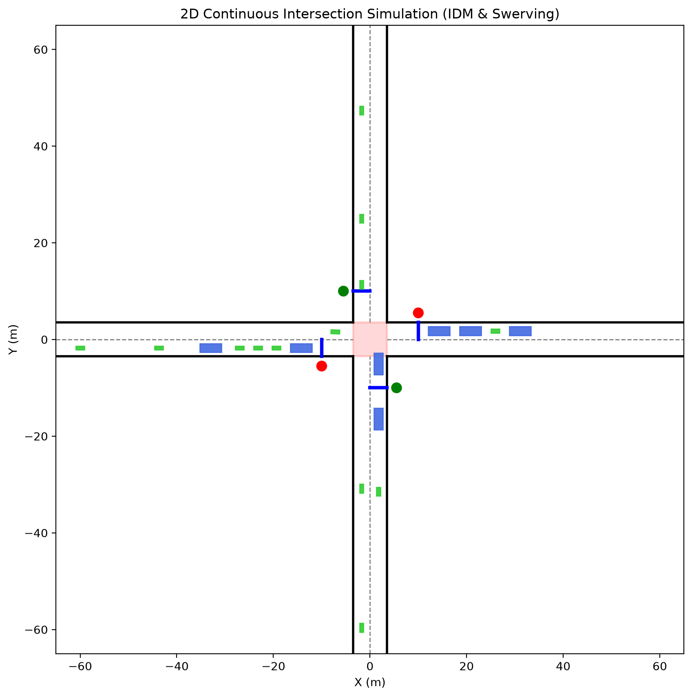

# 2D Continuous Mixed-Traffic Intersection Simulation

Dự án mô phỏng vi mô dòng giao thông hỗn hợp (ô tô và xe máy) tại nút giao thông 4 nhánh sử dụng mô hình bám đuôi **IDM (Intelligent Driver Model)**, hành vi lách làn phi cấu trúc **(Swerving)**, đường cong **Bézier** cho quỹ đạo rẽ, và bộ điều khiển tín hiệu đèn giao thông 2 pha.



---

## 📌 Tính năng chính

- **Mô hình động học phương tiện (Vehicle Dynamics):**
  - Hỗ trợ 2 loại phương tiện chính: Ô tô (`Car`) và Xe máy (`Motorcycle`) với kích thước, vận tốc tối đa và khả năng tăng tốc khác nhau.
- **Mô hình bám đuôi IDM (Intelligent Driver Model):**
  - Tự động điều chỉnh khoảng cách an toàn, bám đuôi và phanh giảm tốc mượt mà.
- **Hành vi lách làn phi làn (Lateral Swerving):**
  - Cho phép xe máy tận dụng khoảng trống ngang để lách qua các ô tô phía trước khi gặp hàng đợi hoặc di chuyển chậm.
- **Điều hướng rẽ mượt mà (Bézier Curves):**
  - Sử dụng đường cong bậc hai (Quadratic Bézier Curves) để tạo quỹ đạo rẽ trái, rẽ phải mềm mại qua ngã tư.
- **Tín hiệu đèn giao thông (2-Phase Signal Controller):**
  - Pha 1: Bắc - Nam (Xanh 37s, Vàng 3s, Đỏ 40s).
  - Pha 2: Đông - Tây (Đỏ 40s, Xanh 37s, Vàng 3s).
  - Tích hợp mô hình quyết định qua vùng lưỡng lự (Dilemma Zone) khi gặp đèn vàng.
- **Giải quyết xung đột và phanh phòng thủ 2D (Conflict Resolution & AEB):**
  - Nhường đường theo luật giao thông (ưu tiên giải phóng xe trong ngã tư, nhường xe đi thẳng, quy tắc rẽ trái - Gap Acceptance, nhường bên phải).
  - Hành lang phanh khẩn cấp phòng thủ để triệt tiêu va chạm ngang thân xe.

---

## 📂 Cấu trúc mã nguồn

```text
Modelling_Itersection/
├── vehicle.py              # Định nghĩa lớp Vehicle và cập nhật động học phương tiện
├── generator.py            # Sinh lưu lượng xe ngẫu nhiên (Poisson/Headway) & gán tuyến (O-D)
├── control.py              # Bộ điều khiển xe: IDM, Swerving, Bézier navigation, xử lý xung đột
├── signal_controller.py    # Bộ điều khiển chu kỳ đèn tín hiệu 2 pha
├── geometry.py             # Bản vẽ tĩnh cấu trúc nút giao thông 2D
├── main.py                 # File chính chạy mô phỏng đồ họa động bằng Matplotlib
├── requirements.txt        # Các thư viện phụ thuộc
└── README.md               # Tài liệu hướng dẫn dự án
```

---

## 🚀 Cài đặt & Chạy mô phỏng

### 1. Yêu cầu hệ thống
- Python 3.8 trở lên.

### 2. Cài đặt thư viện
```bash
pip install -r requirements.txt
```

### 3. Khởi chạy mô phỏng
```bash
python main.py
```

- Ô tô hiển thị dưới dạng hình chữ nhật **xanh dương (Blue)**.
- Xe máy hiển thị dưới dạng hình chữ nhật **xanh lá (Green)**.
- Đèn tín hiệu giao thông hiển thị tại 4 góc tiếp cận của ngã tư.
